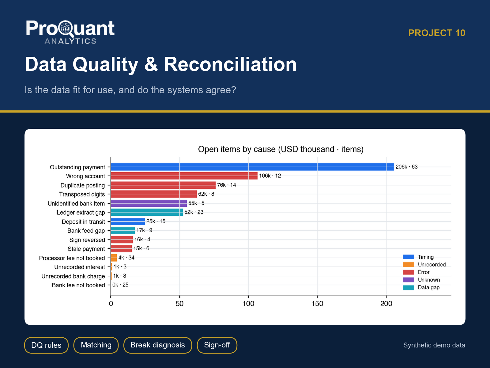
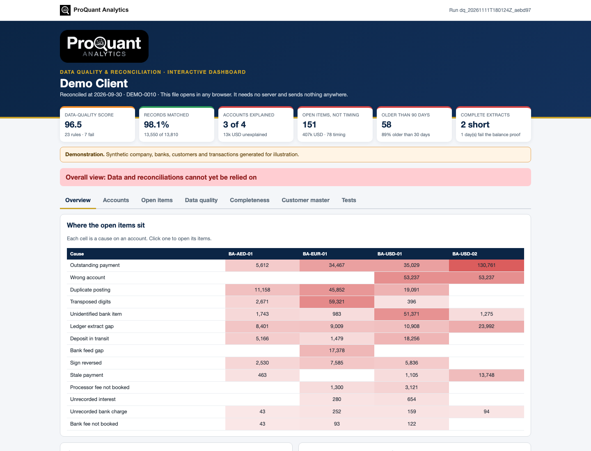
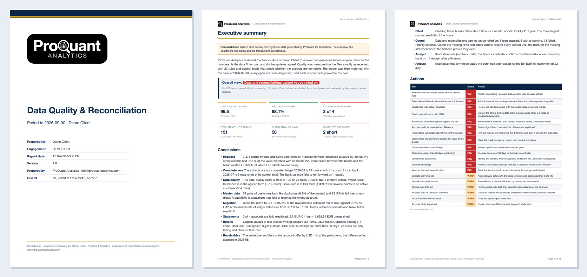
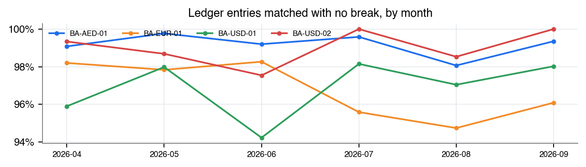
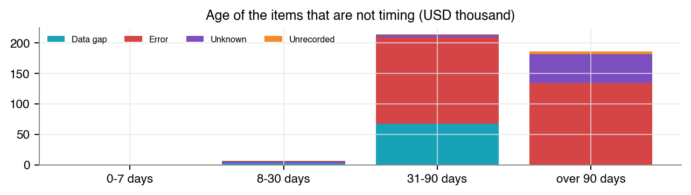
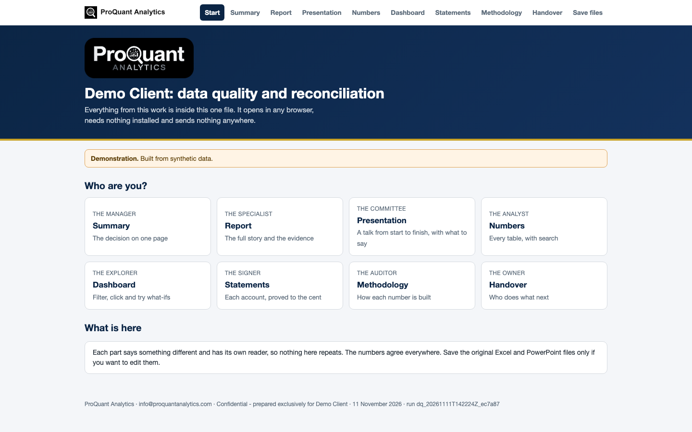

# Data Quality & Reconciliation

**Is the data fit for use, and do the systems agree? Measured, matched and explained line by line.**

  

> **Showcase repository.** It shows the method and the actual files a client receives, built on **synthetic demo data** (a fictional *Demo Client*). The numbers below are illustrative, not client results. The production code is proprietary and is not published here.

## Contents

- [Business problem](#business-problem)
- [Approach](#approach)
- [Results (demo)](#results-demo)
- [Deliverables](#deliverables)
- [Gallery](#gallery)
- [Tech stack](#tech-stack)
- [How to view it](#how-to-view-it)
- [How an engagement works](#how-an-engagement-works)

## Business problem

Month-end takes days because people match lines by eye. Old differences sit in suspense, an interface posts receipts twice, a bank statement never arrives, and nobody notices until the auditor asks.

**Typical clients:** Finance, treasury and operations teams; fund administrators; companies migrating systems.

## Approach

- 23 declarative data-quality rules in six dimensions, run on the files exactly as received
- Control totals for every extract and a daily balance proof of the bank file
- Four-pass matching from strict to tolerant, with every pair recording its pass
- Diagnosis of each break: timing, fees, transposed digits, reversed sign, duplicates, feed gaps
- Reconciliation statement per account with signature lines; subledger tie-out
- Break tracker with age, owner and next step; Pareto of the hours to clear them

## Results (demo)

**Overall opinion on the demo data:** Overall view: Data and reconciliations cannot yet be relied on

| Measure | Value | Context |
|---|---:|---|
| Data-quality score | **96.5** | 23 rules · 7 fail |
| Records matched | **98.1%** | 13,550 of 13,810 |
| Accounts explained | **3 of 4** | 13k USD unexplained |
| Open items, not timing | **151** | 407k USD · 78 timing |
| Older than 90 days | **58** | 89% older than 30 days |
| Complete extracts | **2 short** | 1 day(s) fail the balance proof |

<em>The interactive dashboard (one HTML file). <a href="https://abduwars.github.io/proquant-10-data-quality-reconciliation/sample-delivery/10_DemoClient_DataQualityRecon_Dashboard_v1.0_20261111.html">Open it live</a>.</em>

## Deliverables

Everything opens from **one file**, *Start here* (no. 1), in any browser: pick your role, read each document, watch the presentation, search the tables and use the dashboard. Each document has one reader and one job, and the numbers agree across all of them. PowerPoint and Excel files open in the browser through Microsoft's free online viewer; *download* gives the original file.

| # | File | Format | What it is |
|---|---|---|---|
| 1 | [Start here](https://abduwars.github.io/proquant-10-data-quality-reconciliation/sample-delivery/00_START_HERE_DemoClient.html) | HTML (opens in any browser) | **One file that holds it all**: every document, the presentation, the tables and the dashboard |
| 2 | [Report](sample-delivery/01_DemoClient_DataQualityRecon_Report_v1.0_20261111.pdf) | PDF | *The specialist*: The full story with the evidence and the main charts (~15 pages) |
| 3 | [Summary](sample-delivery/02_DemoClient_DataQualityRecon_Summary_v1.0_20261111.pdf) | PDF | *The manager*: The decision: the answer, three numbers, the decisions needed. No charts |
| 4 | [Presentation](https://view.officeapps.live.com/op/view.aspx?src=https%3A%2F%2Fabduwars.github.io%2Fproquant-10-data-quality-reconciliation%2Fsample-delivery%2F03_DemoClient_DataQualityRecon_Presentation_v1.0_20261111.pptx) | PowerPoint · [download](https://raw.githubusercontent.com/AbduWars/proquant-10-data-quality-reconciliation/main/sample-delivery/03_DemoClient_DataQualityRecon_Presentation_v1.0_20261111.pptx) | *The committee*: A complete 16-slide talk. **Native charts** the presenter can edit and **speaker notes on every slide**, so anyone can present it |
| 5 | [Results Workbook](https://view.officeapps.live.com/op/view.aspx?src=https%3A%2F%2Fabduwars.github.io%2Fproquant-10-data-quality-reconciliation%2Fsample-delivery%2F04_DemoClient_DataQualityRecon_ResultsWorkbook_v1.0_20261111.xlsx) | Excel · [download](https://raw.githubusercontent.com/AbduWars/proquant-10-data-quality-reconciliation/main/sample-delivery/04_DemoClient_DataQualityRecon_ResultsWorkbook_v1.0_20261111.xlsx) | *The analyst*: A working file with **live formulas**: a Control panel that recalculates by account, statements rebuilt cell by cell, required rates you can change; named tables for Power Query, Power BI and pivots. No narrative |
| 6 | [Methodology](sample-delivery/05_DemoClient_DataQualityRecon_Methodology_v1.0_20261111.pdf) | PDF | *The auditor*: Steps and formulas, the parameters of the run, worked examples and the rule catalogue. No results |
| 7 | [Handover Note](sample-delivery/06_DemoClient_DataQualityRecon_HandoverNote_v1.0_20261111.pdf) | PDF | *The owner*: Who does what by when, which file is for whom, how the files work together |
| 8 | [Break Tracker](https://view.officeapps.live.com/op/view.aspx?src=https%3A%2F%2Fabduwars.github.io%2Fproquant-10-data-quality-reconciliation%2Fsample-delivery%2F07_DemoClient_DataQualityRecon_BreakTracker_v1.0_20261111.xlsx) | Excel · [download](https://raw.githubusercontent.com/AbduWars/proquant-10-data-quality-reconciliation/main/sample-delivery/07_DemoClient_DataQualityRecon_BreakTracker_v1.0_20261111.xlsx) | *The item owners*: Every item with an owner, a next step and a status drop-down; a Progress sheet that follows it; data issues, failed rows and candidate duplicates |
| 9 | [Reconciliation Statement](sample-delivery/08_DemoClient_DataQualityRecon_ReconciliationStatement_v1.0_20261111.pdf) | PDF | *The signer*: Each account line by line, with preparer and reviewer signatures |
| 10 | [Dashboard](https://abduwars.github.io/proquant-10-data-quality-reconciliation/sample-delivery/10_DemoClient_DataQualityRecon_Dashboard_v1.0_20261111.html) | HTML (opens in any browser) | *Whoever explores*: Heat map of causes by account (click to drill), age against value, **what-if simulators**, and **Load the updated tracker**: it reads the Excel tracker on the computer and shows progress |

**Delivered to clients only, not in this showcase:** DQ rule pack (YAML, SQL and self-test).

Also delivered: data-quality reports and long-format CSV / Parquet exports for Power BI or Looker Studio.

<em>The first pages of the PDF report.</em>

## Gallery

<table><tr>
<td width="50%"></td>
<td width="50%"></td>
</tr></table>

<em>The start page: one file, one click, nothing to install.</em>

## Tech stack

Python · pandas · NumPy · matplotlib · Jinja2 + WeasyPrint (PDF) · openpyxl (Excel) · python-pptx (PowerPoint) · pydantic · pytest

Every run is reproducible and audited: data fingerprints, configuration and code version are recorded, data-quality checks run before any calculation, and an automated test suite checks every deliverable (including opening the decks and workbooks in Microsoft Office).

## How to view it

1. **In the browser (nothing to install):** open the [live start page](https://abduwars.github.io/proquant-10-data-quality-reconciliation/sample-delivery/00_START_HERE_DemoClient.html) or the [dashboard](https://abduwars.github.io/proquant-10-data-quality-reconciliation/sample-delivery/10_DemoClient_DataQualityRecon_Dashboard_v1.0_20261111.html).
2. **Download:** click any PDF, Excel or PowerPoint file in the table above, or clone the repository: `git clone https://github.com/AbduWars/proquant-10-data-quality-reconciliation.git`.
3. **On your own data:** this is delivered as a fixed-scope engagement. Write to [info@proquantanalytics.com](mailto:info@proquantanalytics.com).

## How an engagement works

| Step | What happens |
|---|---|
| 1. Discovery call | Your question, your data and the decision the work must support |
| 2. Scope and NDA | Fixed scope, timeline and thresholds agreed **before** any result is seen |
| 3. Data request | A precise list of files or read-only access; personal data pseudonymised |
| 4. Build and interim update | First results, open questions and data issues, early |
| 5. Delivery | The full package above, on your data, with a walk-through |
| 6. Handover | Methodology, runbook where relevant, and optional monthly refresh |

---

<b>ProQuant Analytics</b> · Quant & risk analytics, business analytics, data engineering and AI automation Rotterdam, NL · remote-first <a href="https://www.proquant-analytics.com">www.proquant-analytics.com</a> · <a href="mailto:info@proquantanalytics.com">info@proquantanalytics.com</a> · <a href="https://github.com/AbduWars">All 13 projects</a>

© 2026 ProQuant Analytics. Sample outputs on synthetic data, shown for demonstration. All rights reserved.

